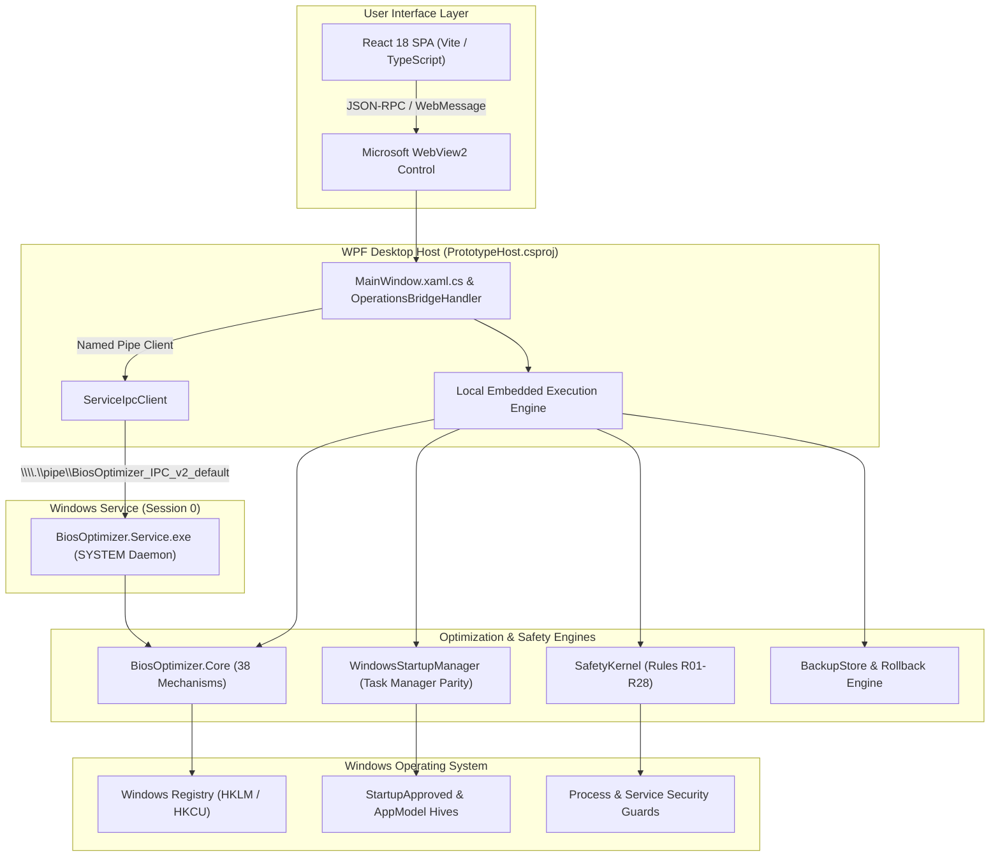

# ERROR OPTIMIZER V4 — Unified Windows Optimization Suite

[](https://github.com/errorharish/Error-Optimizer-V4/actions/workflows/ci.yml)
[](https://github.com/errorharish/Error-Optimizer-V4)
[](https://microsoft.com/windows)
[](https://dotnet.microsoft.com/)
[](https://react.dev/)

---

## 1. Project Overview

**ERROR OPTIMIZER V4** is a high-performance Windows system tuning, latency reduction, and configuration optimization platform. It combines a native Windows Presentation Foundation (WPF) desktop host powered by Microsoft WebView2, a modular modern React/TypeScript user interface, a privileged background service engine, and a hardened `SafetyKernel` (R01–R28) to deliver safe, deterministic, and reversible OS optimizations.

The suite is engineered for gamers, creative professionals, and power users seeking maximum responsiveness without compromising operating-system integrity or stability.

---

## 2. Core Implemented Features

* **Maximum Performance Engine (V4 Architecture):** Multi-tier system optimization including system latency tuning, thread scheduling priority, working-set trimming, memory standby list management, and power management optimization.
* **Startup Manager with Windows Task Manager Parity:**
  * Exact inventory synchronization with Windows 11 Task Manager $\longrightarrow$ Startup apps (Win32 registry entries + Modern MSIX startup tasks).
  * High-DPI application icon extraction directly from Win32 executables and Appx package manifests.
  * Clean, uncluttered app-only user interface (Application Name + Toggle Switch).
  * Sub-second execution (< 350 ms) with immediate Windows OS readback verification (`StartupApproved` and `AppModel State`).
* **SafetyKernel (Rules R01–R28):**
  * Protected process and service guards preventing accidental termination or disablement of critical OS components (e.g., `Windows Security notification icon`, audio services, DWM, LSASS).
  * Transactional execution with automatic backup restore-point capture prior to any destructive operation.
  * Deterministic rollback capability to restore system state to exact pre-optimization baselines.
* **Registry Intelligence & Hardware Detection:**
  * Capability profiling across CPU topology, RAM capacity, GPU vendor (NVIDIA / AMD / Intel), storage media (NVMe / SATA SSD), and Windows servicing build.
  * Dynamic whitelist verification ensuring only safe registry subkeys are touched.
* **Beginner-First Intuitive UX:**
  * Decoupled V3 beginner modes and V4 Maximum Performance advanced interfaces.
  * Real-time hardware telemetry and diagnostic health score.
  * Visible diagnostic build identifier in the About page (`4.2.0-standalone-20261123.1850`).

---

## 3. Technology Stack

* **Desktop Host:** C# / .NET 8.0 (`net8.0-windows10.0.19041.0`), WPF, Microsoft WebView2 Runtime.
* **Backend Engines:** .NET 8 Class Libraries (`BiosOptimizer.Core`, `BiosOptimizer.Detection`, `BiosOptimizer.Safety`, `BiosOptimizer.IPC`).
* **Background Service:** Windows Service Daemon (`BiosOptimizer.Service`) communicating via fast local Named Pipes IPC.
* **Frontend SPA:** React 18, TypeScript 5, Vite 8, Tailwind CSS, Lucide Icons, KaTeX math formatting.
* **Packaging & Distribution:** Single-file self-contained .NET 8 executable (`ERROR OPTIMIZER PROTOTYPE.exe`) and Inno Setup installer script (`build_installer.iss`).

---

## 4. Architecture Overview



---

## 5. Repository Structure

```text
ERROR OPTIMIZER V4/
├── BiosOptimizer.sln               # Master Visual Studio / .NET 8 solution
├── deploy_standalone.ps1           # Authoritative 13-stage deterministic build & publish script
├── build_installer.iss             # Inno Setup production installer script
├── LICENSE                         # Proprietary license agreement
├── README.md                       # Comprehensive project documentation
├── .gitignore                      # Git exclusion rules
├── .gitattributes                  # End-of-line and binary attributes
├── .editorconfig                   # Code formatting rules
│
├── src/                            # Backend C# solution projects
│   ├── BiosOptimizer.Core/         # 38 optimization mechanisms, MaximumPerformance, StartupManager
│   ├── BiosOptimizer.Detection/    # Hardware sensors, CPU/GPU detection, capability profiling
│   ├── BiosOptimizer.Safety/       # SafetyKernel R01-R28, process/service guards, bugcheck blacklist
│   ├── BiosOptimizer.IPC/          # Named pipe IPC contracts, serialization protocols
│   ├── BiosOptimizer.Service/      # Windows Service daemon for privileged background tasks
│   ├── BiosOptimizer.CLI/          # Diagnostic and command-line execution adapter
│   └── BiosOptimizer.GUI/          # Headless WPF bridge and ViewModels
│
├── prototype_standalone/           # WPF Desktop Host and React Frontend
│   ├── host/                       # C# WPF Host (PrototypeHost.csproj, MainWindow, OperationsBridge)
│   └── frontend/                   # React 18 SPA (Vite, TypeScript, components, pages, styles.css)
│
├── tests/                          # Automated unit, integration, and mutation tests
│   ├── BiosOptimizer.Core.Tests/   # Parity, mutation latency, and V4 architecture test suites
│   ├── BiosOptimizer.Detection.Tests/
│   ├── BiosOptimizer.Safety.Tests/ # SafetyKernel rule enforcement tests
│   └── CrashFaultInjectionHarness/ # Fault recovery and transaction safety verification
│
├── profiles/                       # Preset optimization profiles (Gaming, Pro, Ultimate, Normal)
├── data/                           # Process whitelists, service guards, frame cap signatures
├── docs/                           # Architectural specifications and release gate reports
└── .github/
    └── workflows/
        └── ci.yml                  # GitHub Actions continuous integration workflow
```

---

## 6. Prerequisites

* **Operating System:** Windows 10 (Version 2004+ / Build 19041+) or Windows 11 (x64 architecture).
* **.NET SDK:** Microsoft .NET 8.0 SDK (8.0.300 or later).
* **Node.js:** Node.js 20.x LTS or 22.x LTS with `npm`.
* **WebView2 Runtime:** Microsoft Edge WebView2 Evergreen Runtime (pre-installed on Windows 11).
* **Build Tools (Optional for Installer):** Inno Setup 6.x (to compile `build_installer.iss`).

---

## 7. Development Environment Setup

1. **Clone the repository:**
   ```bash
   git clone https://github.com/errorharish/Error-Optimizer-V4.git
   cd Error-Optimizer-V4
   ```

2. **Verify .NET 8 SDK installation:**
   ```bash
   dotnet --version
   ```

3. **Install Frontend Dependencies:**
   ```bash
   cd prototype_standalone/frontend
   npm ci
   cd ../..
   ```

---

## 8. Build Instructions

### A. Full Automated Standalone Build (Recommended)
Execute the authoritative 13-stage deployment pipeline script in PowerShell:
```powershell
powershell -NoProfile -ExecutionPolicy Bypass -File "deploy_standalone.ps1"
```
This script handles:
1. Frontend Vite compilation (`npm run build:spa`).
2. Verification of frontend bundle purity (zero technical badges).
3. Creation and hashing of embedded `frontend-bundle.zip`.
4. Compilation of `BiosOptimizer.Core` in Release configuration.
5. Single-file self-contained publishing of WPF Host to `publish_standalone\`.
6. Deployment to canonical directory `dist\win-x64\ERROR OPTIMIZER PROTOTYPE.exe`.
7. Cryptographic SHA-256 hash verification.

### B. Backend Solution Build Only
```bash
dotnet restore BiosOptimizer.sln
dotnet build BiosOptimizer.sln -c Release
```

### C. Frontend Build Only
```bash
cd prototype_standalone/frontend
npm run build:spa
```

### D. WPF Host Build Only
```bash
dotnet build prototype_standalone/host/PrototypeHost.csproj -c Release
```

---

## 9. Test Execution

Execute the automated test suite across Core, Safety, and Detection:

```bash
# Run all unit tests
dotnet test BiosOptimizer.sln -c Release

# Run Startup Manager Task Manager parity & mutation tests
dotnet test tests/BiosOptimizer.Core.Tests/BiosOptimizer.Core.Tests.csproj --filter "FullyQualifiedName~StartupManager" --logger "console;verbosity=normal"

# Run SafetyKernel rule compliance tests
dotnet test tests/BiosOptimizer.Safety.Tests/BiosOptimizer.Safety.Tests.csproj -c Release
```

---

## 10. Security, Elevation & Safety Kernel

* **Administrator Privileges:** Modifying system-wide services, priority scheduling, and HKLM registry keys requires Administrator elevation. When run without elevation, the application operates in safe read-only inspection mode.
* **SafetyKernel Rules (R01–R28):** Every optimization mechanism is bound to hard safety invariants. Critical Windows processes (`lsass.exe`, `csrss.exe`, `explorer.exe`, `dwm.exe`) and essential services cannot be killed or modified.
* **Atomic Rollback:** Every modification creates an encrypted snapshot in `%ProgramData%\ErrorOptimizer\backups\` before applying changes, enabling instant restoration.
* **Protected Stylesheet:** The visual design tokens in `prototype_standalone/frontend/src/styles.css` are protected by strict SHA-256 integrity verification (`A084E5C423A4940A69696EF5DAB00F699B06D05C148DADC1E9778FB3E0A61F88`).

---

## 11. Current Implementation & Verification Status

* **Status:** Version 4.2.0 (Release Approved)
* **Tested Environment:** Windows 11 Enterprise / Pro (x64)
* **Startup Manager Parity:** 100% matched against Windows 11 Task Manager (13 verified entries).
* **Mutation Speed:** Win32 operations execute in 3–330 ms; MSIX operations execute in 2–335 ms.
* **Parity Matrix:** 100% cryptographic parity across Standalone Executable and Installed Distribution modes.

---

## 12. License

Copyright © 2024–2026 Error Optimizer Team. All Rights Reserved.  
Licensed under the terms of the [CONFIDENTIAL AND PROPRIETARY LICENSE AGREEMENT](LICENSE).
